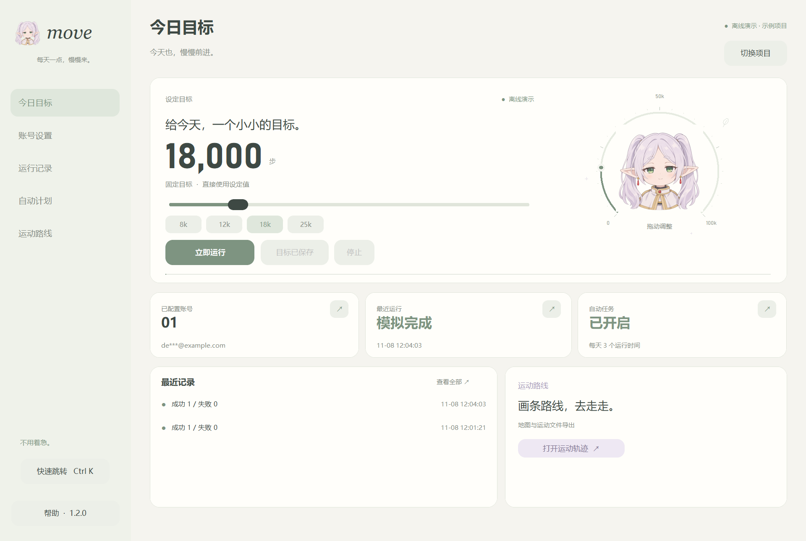
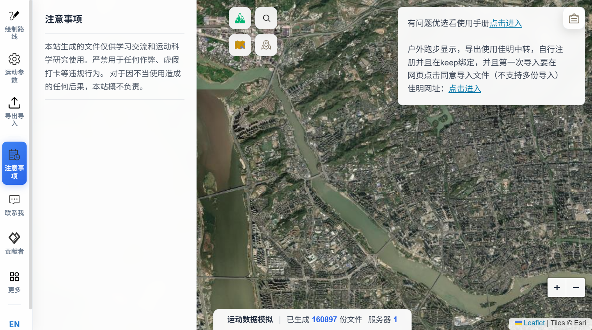

# move

面向 Windows 64 位的轻量桌面软件，提供账号与步数设置、手动运行、运行记录、Windows 自动任务，以及内嵌的在线运动轨迹编辑器。

当前版本：**1.2.0**。

芙莉莲主题：浅米白、鼠尾草绿、淡紫色与 Q 版同人头像，界面保留简约布局。

## 这一版的变化

界面以浅米白、鼠尾草绿和淡紫色为主，采用更安静的留白与简洁布局。数字、运行状态和按钮提供柔和反馈，常用操作保持清晰直接。

- 首页可以通过目标滑块、常用预设和轻量刻度调整目标。修改先作为预览，点击“保存目标”后生效；点击“保存并运行”会先保存再执行。
- 按 `Ctrl+K` 打开快速跳转，搜索页面或常用操作。
- 运行记录支持关键词搜索，以及成功、失败、停止状态筛选。
- 自动任务支持时间标签的添加和移除，状态刷新会保留尚未保存的修改。
- 窗口较小时优先显示目标和操作按钮，记录与地图仍可从左侧进入。
- 运动轨迹窗口的工具栏采用同一配色，内嵌网页保留原站样式。

**目标数字和刻度显示的是设定值，不是实测步数或运动完成率。**

## 下载与使用

从 [Releases](https://github.com/duanwentaotaotaotaotaotao/mimotion-desktop/releases/latest) 下载 Windows exe 或完整压缩包。发布的 exe 已包含 Python 及运行依赖，无需另外安装 Python。

1. 双击软件，选择自己的 mimotion 项目或数据目录。本机存在 `E:\mimotion` 时会优先读取；其他情况可在界面中设置账号。
2. 在“账号设置”设置 Zepp Life 手机号/邮箱，点击“保存设置”。已有密码留空保留。
3. 在“今日目标”调整固定目标并保存。随机范围和按时间递增可在“账号设置”设置。
4. 点击“立即运行”，或对预览中的目标点击“保存并运行”，再到“运行记录”查看结果。打开窗口和拖动目标都不会自动提交步数。
5. 在“自动计划”添加或移除运行时间，再点击“保存自动任务”。自动执行需要电脑开机并登录 Windows。
6. 左侧“运动路线”加载 [sport.gyvv.top 原站](https://sport.gyvv.top/)，可使用地图、路线编辑和 FIT/TCX/GPX/CSV 等导出功能；“大窗口”适合地图编辑。



## 运动轨迹模块

该模块通过 WebView2 在软件中加载原站，需要联网。地图、网页和生成服务由原站提供，本项目未复制网站源码、地图密钥或服务端代码。

- 导出文件默认保存到所选项目的“轨迹导出”，也可以在页面工具栏更改位置。
- 同名下载会另存为新文件。
- 浏览器路线与设置持久保存在项目的 `.mimotion-desktop/sport-web-profile`。
- 原有 MiMotion/Zepp 账号配置不会自动填入该网站。
- 使用系统的 Microsoft Edge WebView2 Runtime；缺少时需安装 [微软官方运行环境](https://developer.microsoft.com/microsoft-edge/webview2/)。



## 本地数据

账号与配置保存在所选目录的 `.env`，保存前会在 `backups/` 备份。登录缓存、日志、浏览器资料和导出文件也保存在该目录，不属于源码。

仓库和 Release 不包含个人账号、密码、已有令牌缓存或浏览器资料。分享自己的数据目录前请自行检查这些本地文件。

软件显示的是接口执行结果；其他运动平台的显示仍取决于其绑定及同步状态。在线轨迹工具的功能和服务可用性取决于原站。

## 从源码运行与构建

开发与测试环境为 Windows 11 64 位、Python 3.14。建议在虚拟环境中安装依赖。

```powershell
python -m pip install -r requirements-build.txt
python app.py
```

构建独立 exe：

```powershell
powershell -NoProfile -ExecutionPolicy Bypass -File .\build.ps1
```

构建脚本会编译 WebView2 宿主、运行核心测试，并把独立软件生成到 `dist/`。宿主编译需要 .NET Framework 4.8 的 C# 编译器，所需 WebView2 SDK DLL 和许可已保存在 `assets/sport_host/`。普通用户使用发布版无需编译。

核心测试：

```powershell
python -m unittest discover -s . -p test_backend.py -v
```

离线模拟（使用专门的测试目录和虚构账号）：

```powershell
python app.py --project .\test-data --demo
```

`--demo` 不连接 Zepp，也不修改自动任务；仍会在测试目录保存设置和模拟日志。运动轨迹页面加载的是独立在线工具，访问它仍需要网络。

## 代码结构

- `app.py`：桌面界面与页面导航。
- `studio_ui.py`、`studio_widgets.py`：界面布局、目标控件、轻量动画和交互反馈。
- `backend.py`：配置、独立运行进程、日志与 Windows 自动任务。
- `sport.py`、`sport_host_src/`：WebView2 内嵌页面、下载与生命周期管理。
- `engine.py`、`util/`：基于上游本机版本的 MiMotion 核心；打包副本修复了首次登录未设置实例 `user_id` 的问题。
- `assets/`：图标、宿主程序、WebView2 SDK 文件与第三方许可。

更多操作和验证范围见 [使用说明](docs/使用说明.txt) 与 [验证记录](docs/验证记录.md)。本轮源码验证覆盖目标预览与保存、界面交互、核心模拟和本地浏览器下载测试。测试没有使用真实账号提交步数，真实平台同步仍需按实际运行结果判断。

## 来源与许可

- MiMotion 上游：[TonyJiangWJ/mimotion](https://github.com/TonyJiangWJ/mimotion)，沿用 Apache-2.0；见 [LICENSE](LICENSE)、[原许可证](LICENSE-mimotion.txt) 和 [NOTICE](NOTICE.txt)。
- 在线运动轨迹工具：[sport.gyvv.top](https://sport.gyvv.top/)，由原站独立提供。
- WebView2 SDK 许可：[LICENSE-WebView2.txt](assets/sport_host/LICENSE-WebView2.txt)。
- 其他依赖许可：[THIRD-PARTY-LICENSES.txt](assets/THIRD-PARTY-LICENSES.txt)。


图标由内置 image_gen 生成，为芙莉莲同人头像；生成说明和提示词见 [icon-prompt.txt](assets/icon-prompt.txt)。
